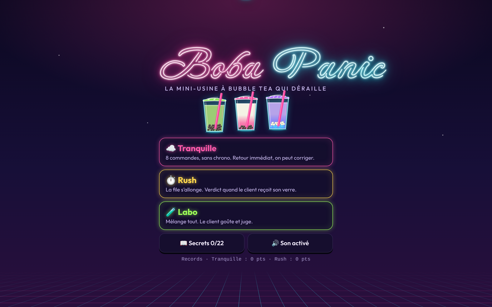
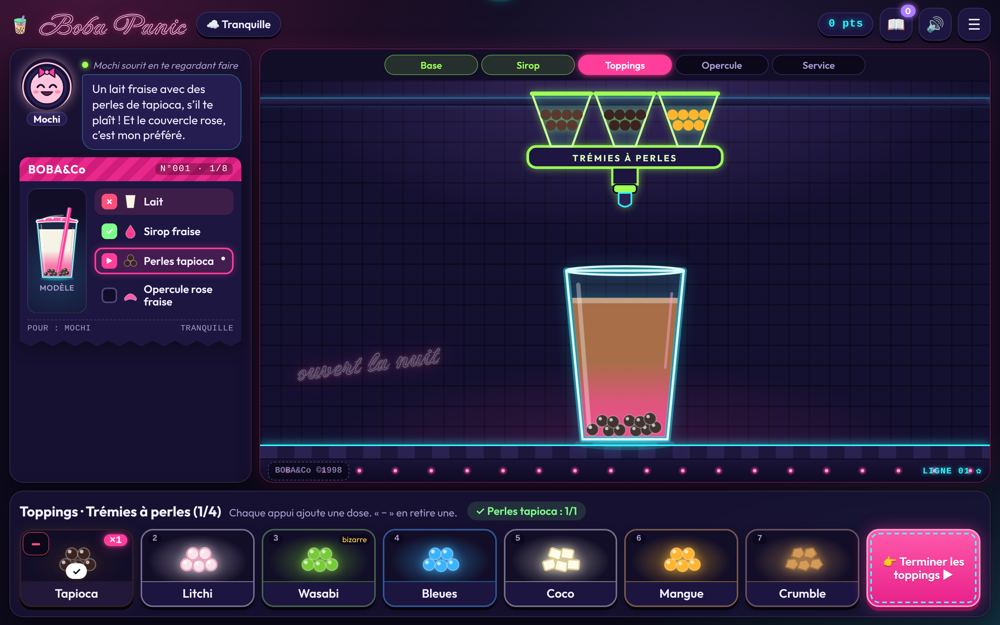
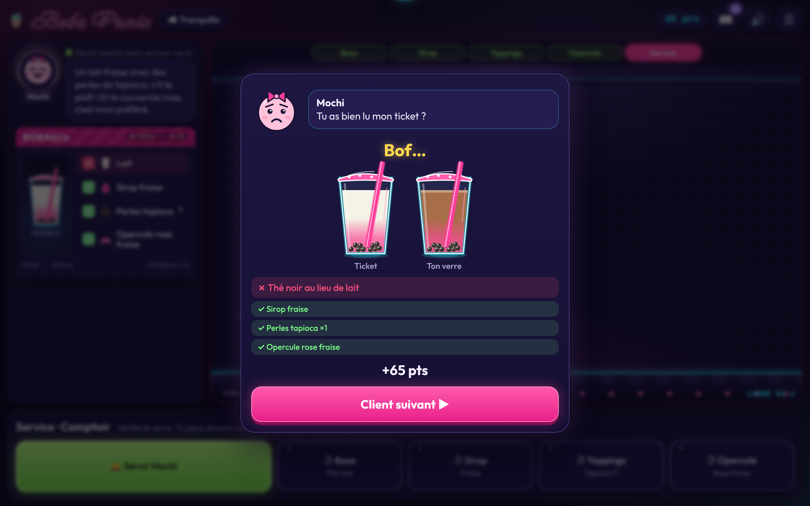
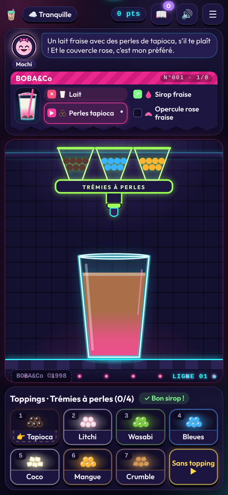

# 🧋 Boba Panic

Une mini-usine mignonne de bubble tea, jouable dans le navigateur sur PC et sur téléphone.

**▶ Jouer : https://nihirii.github.io/boba-panic/**

Un client passe commande, le gobelet avance sur le tapis roulant et tu le prépares poste par poste : base, sirop, toppings, opercule, puis service. Les recettes peuvent être délicieuses… ou franchement dégueu (chocolat-cornichon, lait fraise aux perles wasabi, thé noir à l'ail).

## Direction artistique : néon / nuit

Un boba shop ouvert tard le soir : fond bleu nuit, enseignes néon roses et cyan, grille rétro qui défile sous le menu.

- **Couleurs** : rose néon `#ff3d9a`, cyan `#2ff3ff`, violet taro `#b07cff`, vert matcha `#9dff57` et or `#ffd84d` sur un fond `#0d0a1c`.
- **Typo** : [Outfit](https://fonts.google.com/specimen/Outfit) pour l'interface, [Neonderthaw](https://fonts.google.com/specimen/Neonderthaw) pour les enseignes.
- **Usine** : mur de briques sombres avec l'enseigne « ouvert la nuit », une couleur néon par machine (cuve rose, pompes violettes, trémies vertes, presse dorée), tapis à LED.
- **Gobelets et clients** : verre à contour cyan lumineux, avatars cerclés d'un anneau néon.
- Les animations néon se coupent si le système demande moins d'animations.

| L'usine | Le verdict |
| --- | --- |
|  |  |

## Modes

- **☁️ Tranquille** : 8 commandes sans chrono, avec un retour immédiat et la possibilité de corriger.
- **⏱️ Rush** : la file s'impatiente, le verdict tombe quand le client reçoit son verre.
- **🧪 Labo** : mélange tout librement. Le client goûte, donne une note et réagit à la recette.

## Commandes

- Souris ou toucher : un appui sur un ingrédient le verse, puis le tapis avance.
- Clavier : touches **1 à 7** pour choisir, **Entrée** pour l'action principale (Sans sirop, Terminer les toppings, Servir), **−** pour retirer une dose de topping.

## Secrets

22 secrets sont cachés dans l'usine : recettes secrètes, réactions de clients et interactions avec le décor. Le carnet 📖 garde la trace des découvertes et propose des indices. La progression et les records sont enregistrés dans le navigateur (`localStorage`).

## Technique

Un seul fichier `index.html` autonome : HTML, CSS et JavaScript, sans dépendance. Les sons sont générés avec la Web Audio API.
